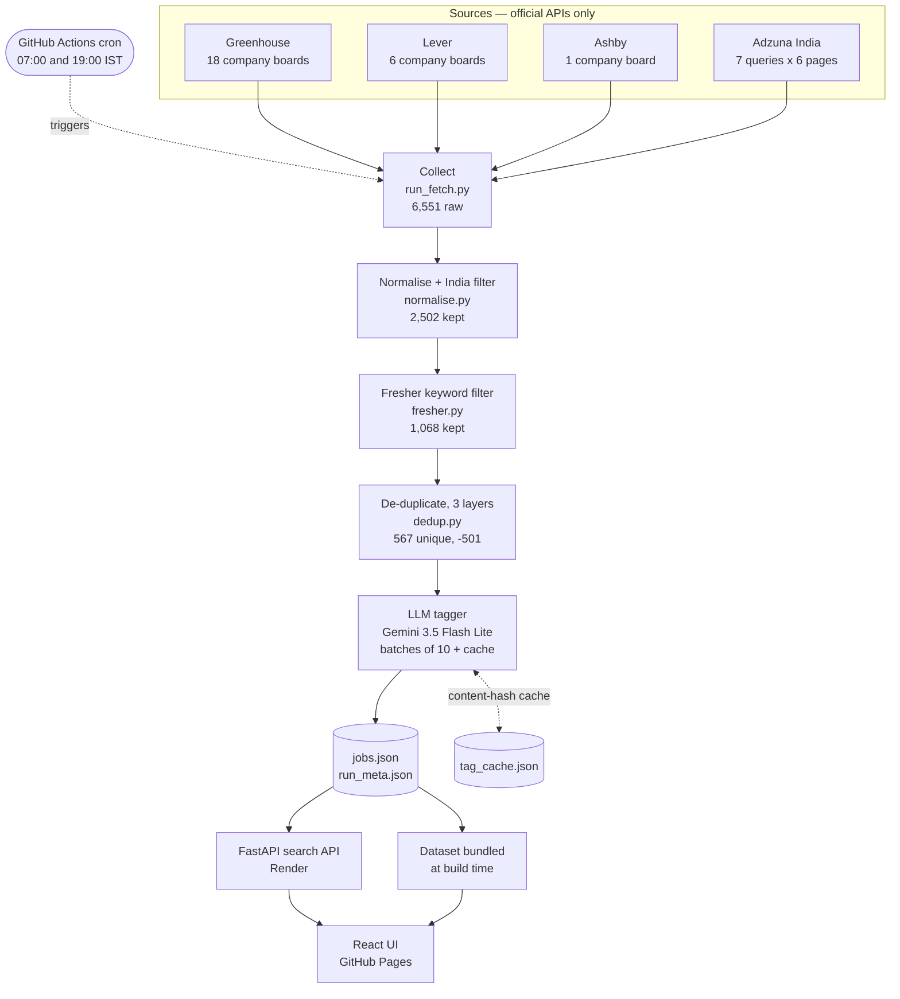

# Beep — Fresher Jobs Radar

**500+ real fresher jobs and internships in India, de-duplicated, AI-tagged by role and city, refreshed twice a day.**

[🌐 Live demo](#) <!-- TODO: fill — GitHub Pages URL --> ·
[🎥 Loom walkthrough](#) <!-- TODO: fill — Loom link --> ·
[📄 Data & prompts sheet](#) <!-- TODO: fill — sheet link --> ·
[🔌 Live API](https://beep-6fn4.onrender.com/docs) ·
[📦 Repo](https://github.com/Dbhosale146/Beep-)

---

## 📌 TL;DR

| | |
|---|---|
| **Posts published** | **562** (from 6,551 raw, run of 2026-11-20) |
| **Duplicates removed** | **501** across three layers |
| **Tag accuracy** (50 checked against live listings) | **role 92%** · **city 82%** · **is_fresher 98%** |
| **Cost per 1,000 posts** | **$0.1588** |

Supporting numbers: 18 role categories, 38 distinct cities in the current
output, 0 posts left untagged, 104 tests, 0 scrapers.

---

## 💡 Problem & approach

- **Fresher job hunting in India is a de-duplication problem, not a search
  problem.** The same role is posted on an ATS board, aggregated by Adzuna, and
  reposted days later. 501 of 1,068 candidate posts in the last run were
  duplicates — 47%.
- **Official APIs only, no scraping.** Every source is a documented public JSON
  endpoint. Nothing parses HTML, nothing ignores a `robots.txt`, nothing needs a
  disguised user-agent. That decision cost coverage and bought a system that
  will not break or get blocked next week.
- **Cheap filters run before expensive ones.** Keyword rules cut 2,502 posts to
  1,068, and de-duplication cuts that to 567, *before* the LLM sees anything.
  The model is the most expensive stage, so it runs on the smallest possible set.
- **The model is never trusted to invent a value.** The taxonomy goes into the
  request as a JSON schema `enum`, so an off-taxonomy answer is structurally
  impossible — and the response is validated in Python regardless. One retry,
  then the post is published as `Untagged`. It never guesses.

---

## 🏗️ Architecture



**Why the UI has two data paths.** GitHub Pages cannot run Python. If the page
could only talk to the API, the published link — the thing actually being
reviewed — would be dead whenever the free API is asleep or undeployed. So the
build bundles the dataset and the page searches it in-browser; setting one
repository variable switches the same page to the live API instead. The cost is
that the search contract exists twice, in Python and JavaScript, which is only
safe because it is small, frozen, and diffed across 20 query sets.
`backend/api/main.py` is the source of truth.

---

## 🔄 One post, end to end

Following a single Adzuna listing through the pipeline:

1. **Collected.** `GET https://api.adzuna.com/v1/api/jobs/in/search/1?what=intern&max_days_old=30&results_per_page=50`
   returns a listing titled `Social Media Intern`, company `Hypersonix`,
   location `India`.
2. **Normalised** into the one internal schema: `id, source, source_id, title,
   company, raw_location, city_guess, department, employment_type, description,
   url, posted_at, fetched_at`. `city_guess` is a cheap alias lookup — it decides
   whether the post is in India at all, and later gives the model a candidate to
   confirm rather than a blank to guess at.
3. **Fresher check.** The title matches the word-bounded pattern `intern`, so it
   is kept with reason `title_positive:intern`. Word-bounded matters — see
   [What broke](#️-what-broke--how-i-fixed-it).
4. **De-duplicated.** Its canonical URL has not been seen; its
   company + title + city hash is new; no title within Hypersonix scores ≥ 90
   against it. Kept.
5. **Tag cache checked.** SHA-256 of
   `title + company + location + description + prompt version` — a miss, so it
   goes to the model.
6. **Tagged.** Sent in a batch of 10. The schema forces `role` to one of 18
   values and `city` to one of 60. Returns `Marketing & Growth`, `Pan India`,
   `is_fresher: true`. Python re-validates, then the result is cached under that
   hash.
7. **Published** to `jobs.json`, committed by the workflow, served by the API and
   bundled into the frontend build.

On the next run, step 5 hits the cache and step 6 costs nothing. In the
2026-11-20 run, **567 of 567 posts were cache hits — the whole run cost $0.00.**

---

## 🌐 Data sources & compliance

| Source | Method | Raw collected | Published | Terms / compliance note |
|---|---|---|---|---|
| **Greenhouse** | Public JSON API — `boards-api.greenhouse.io/v1/boards/{board}/jobs` | 4,601 | 3 | Documented public endpoint, no key, no auth. Boards listed in `config/companies.yaml` |
| **Lever** | Public JSON API — `api.lever.co/v0/postings/{company}?mode=json` | 321 | 5 | Documented public endpoint, no key |
| **Ashby** | Public JSON API — `api.ashbyhq.com/posting-api/job-board/{board}` | 7 | 0 | Documented public endpoint, no key |
| **Adzuna** | Official REST API with a registered key — `api.adzuna.com/v1/api/jobs/in/search/{page}` | 1,622 | 554 | Free tier, key from `developer.adzuna.com`. Their ToS permits personal job search and personal/academic research. ~2,500 calls a month, which is what sets the refresh schedule |

**No HTML scraping anywhere.** No `robots.txt` is touched, because no crawler
exists. Every request goes to a JSON endpoint the provider publishes for
programmatic use.

**The honest weakness.** Greenhouse contributed 4,601 raw postings and 3
survivors — those boards are mostly US companies with few India-based fresher
roles. 554 of 562 published posts come from Adzuna. That is a research gap,
finding Indian companies that use these ATS boards, not a code gap. It is the
first thing I would fix.

---

## 🧹 De-duplication

Three layers, cheapest first, each catching what the previous one cannot.

| Layer | Method | Catches | Removed |
|---|---|---|---|
| 1 — exact | `(source, source_id)` seen before, **or** canonical URL seen before (query string stripped, trailing slash removed, lowercased) | The same post returned by two of our seven Adzuna queries | **352** |
| 2 — hash | Normalised `company + title + city_guess` | The same role posted on an ATS board *and* picked up by the aggregator, with different ids and URLs | **103** |
| 3 — fuzzy | `rapidfuzz`, within one company only: `token_sort_ratio ≥ 90` **or** `token_set_ratio ≥ 95` | `Software Engineer Intern` vs `Intern - Software Engineer`; `Data Analyst` vs `Data Analyst (Fresher)` | **46** |
| | | **Total** | **501 of 1,068 — 47%** |

**Why fuzzy matching is scoped to one company.** Comparing every title against
every other is O(n²) and, worse, wrong: `Software Engineer Intern` at two
different companies is two real jobs. Scoping to a single employer makes it both
cheap and correct.

**Why two ratios.** `token_sort_ratio` catches reordering and typos.
`token_set_ratio` catches one title being the other plus a qualifier — it scores
`Data Analyst` / `Data Analyst (Fresher)` as a match where `token_sort_ratio`
does not. Both thresholds are deliberately high: a false merge silently deletes
a real job, which is worse than showing a near-duplicate.

---

## 🤖 LLM tagging

| | |
|---|---|
| Model | `gemini-3.5-flash-lite` |
| Batch size | 10 posts per call |
| Input per post | title, company, raw location, first **600 characters** of the description |
| Structured output | JSON schema with `enum` constraints on `role` and `city` |
| Validation | Python re-validates every field after the schema |
| On invalid output | **one** retry, then publish as `Untagged` — never a guess |
| Caching | SHA-256 of `title + company + location + description + prompt version` |
| Untagged in the last run | **0** |

**Role taxonomy — 18 values.** Software Engineering · Frontend Engineering ·
Backend Engineering · Mobile Engineering · Data Science & Analytics · Data
Engineering · Machine Learning & AI · DevOps & Infrastructure · QA & Testing ·
Security Engineering · Product Management · Design (UI/UX) · Sales & Business
Development · Marketing & Growth · Operations & Support · Finance & Accounting ·
Human Resources · Other

**City normalisation.** 57 canonical Indian cities with alias lists
(`Bangalore → Bengaluru`, `Gurgaon → Gurugram`, `Powai → Mumbai`), plus three
special values: `Remote`, `Pan India` for country- or state-only locations such
as a bare `"India"`, and `Multiple`. 38 distinct cities appear in the current
output.

**Why the enum matters more than the prompt.** Asking a model nicely for one of
18 values gets you 18 values *most* of the time. Putting the list in the response
schema makes anything else structurally impossible to emit. The Python validator
still runs — because a schema protects against the model, not against a future
SDK change or a bad config.

**Prompt versioning.** Prompts are plain text files in `backend/prompts/`, not
inline strings, and the version is part of the cache key — so editing a prompt
invalidates exactly the cached tags it should and nothing else. `tag_v2` exists
because `tag_v1` had no rule for country-only locations.

<details>
<summary><b>The exact tagging prompt (backend/prompts/tag_v2.txt)</b></summary>

```text
You classify Indian fresher job and internship posts. You will be given a
numbered list of posts. Return one object per post, in the same order, using
the index number you were given.

For each post decide three things.

1. role -- the single best match from this list and nothing else:
{ROLES}

2. city -- the work location, from this list and nothing else:
{CITIES}
   Rules for city, in priority order:
   - If the post names one city, answer that city, using the canonical name
     exactly as written above. "Bangalore" is "Bengaluru". "Gurgaon" is
     "Gurugram". "Trichy" is "Tiruchirappalli".
   - A neighbourhood or suburb counts as its city: "Padmanabhnagar, Bangalore"
     is "Bengaluru", "Powai" is "Mumbai".
   - If only a state or the country is given with no city -- for example
     "India", "Karnataka, India", "West Bengal" -- answer "Pan India".
   - If the post is fully remote or work-from-home, answer "Remote".
   - If the post names two or more different cities, answer "Multiple".
   - If a single city is named but is genuinely not in the list above, answer
     "Multiple" rather than inventing a name.

3. is_fresher -- true only if this post is genuinely open to someone with no
   more than one year of experience, or is an internship, apprenticeship,
   trainee or new-graduate role. Set it to false for anything asking for two
   or more years, and for senior, lead, staff, principal or manager roles,
   even if the title contains the word "intern" as part of another word such
   as "internal".

Judge only from the text given. Do not use outside knowledge about the
company. Do not guess at a value you cannot support from the post.

Posts:
{POSTS}
```

`{ROLES}` and `{CITIES}` are injected from `config/taxonomy.yaml` — the same
file that builds the response schema, so the prompt and the schema cannot drift
apart.

</details>

---

## 📊 Evaluation

50 posts drawn with `scripts/sample_for_eval.py`. **Every listing was opened on
its live source page** and the model's three tags compared against it.

| Metric | Result | 95% CI |
|---|---|---|
| **Role accuracy** | **46/50 = 92%** | 81–97% |
| **City accuracy** | **41/50 = 82%** | 69–90% |
| **`is_fresher` accuracy** | **49/50 = 98%** | 90–100% |
| Role *and* city both correct | 38/50 = 76% | 63–86% |
| All three correct | 37/50 = 74% | 60–84% |

Labelled sheet: [`backend/data/eval_sample_labelled.csv`](backend/data/eval_sample_labelled.csv)
— one row per post with the live-page evidence in the `notes` column.

### The finding that matters: none of the 9 city errors is a tagging error

Checked against what the model was actually given, **every one of the nine
"wrong" cities is the model correctly following the prompt on incomplete
input.**

| Cause | Count | What the model saw | What it answered | Truth |
|---|---|---|---|---|
| **Source data was country-only** | **6** | `raw_location: "India"` | `Pan India` — the documented rule for a country-only location | A real city on the live page (Delhi ×2, Mumbai, Bengaluru, Halol, Delhi) |
| **City missing from the taxonomy** | **3** | `Anand, Gujarat` · `Rewari, Haryana` · `Daman, Daman and Diu` | `Multiple` — the documented fallback for a city not in the list | Anand · Bawal · Daman |
| **Model ignored the prompt** | **0** | — | — | — |

Both causes are fixable without touching the prompt or the model:

1. **Enrich the location from the detail page.** Adzuna's *search* endpoint
   returns `"India"` for some listings while the detail page names the city.
   The pipeline currently trusts the search response. Fetching the detail page
   for country-only locations would recover 6 of 9.
2. **Add the three missing cities** to `config/taxonomy.yaml`. This is the same
   class of bug as the earlier "170 posts tagged Multiple" one — my list of
   India, not the model's reading of it.

### The four role errors are genuine model errors

| # | Title | Tagged | Should be | Why it was wrong |
|---|---|---|---|---|
| 9 | Robotics Engineer Fresher | Software Engineering | Other | Teaching robotics classes to children aged 8–16 |
| 18 | Young Leader (YL) Trainee | Operations & Support | Other | A two-year education fellowship at a non-profit |
| 22 | AI Artist Interns | Machine Learning & AI | Design (UI/UX) | Creates images and video with generative tools — creative work, not ML engineering |
| 41 | Manufacturing Engineering Intern | Software Engineering | Other | Mechanical work: CAD and robot assembly |

**One failure mode, four times: the model weights a technical word in the title
above what the description actually says.** `Robotics`, `AI`, `Engineering` all
pulled it toward an engineering category when the body text said otherwise. The
fix is not a better prompt — it is giving the model more of the description. It
currently sees the first 600 characters (`llm_description_chars`), and in all
four cases the disqualifying detail sits further down.

### The one `is_fresher` error

Post 49, a Paytm listing from **Lever**, not Adzuna: the requirements say
*"1+ years experience in customer support"* and the model called it a fresher
role. The title `CST - Associate - Bill Payments CST` carries no experience
signal, so the keyword filter passed it through and the model had to decide
from the description alone.

### Two things the evaluation surfaced that are not accuracy

- **5 of 50 listings had already been removed** from Adzuna by the time they
  were checked, days after collection. That is the argument for a scheduled
  refresh stated as a measured number rather than an assumption.
- **One listing is a likely scam** (post 31: offers jobs "through backdoor
  process"). The pipeline has no quality filter, only a relevance filter. For a
  product aimed at students, that is a gap worth naming.

Reproduce:

```bash
cd backend
python scripts/score_eval.py data/eval_sample.csv
```

---

## 💰 Cost per 1,000 posts

Measured, not estimated. Every LLM call writes its token counts to
`data/usage_log.jsonl`, and the report is computed from that log with prices
passed in as arguments — so the number always reflects prices checked today,
never a constant that has silently gone stale.

```bash
cd backend
python scripts/cost_report.py --input-price 0.30 --output-price 2.50
```

| Step | Value |
|---|---|
| Model | `gemini-3.5-flash-lite` |
| Prices used | **$0.30** per 1M input tokens · **$2.50** per 1M output tokens |
| Posts tagged, cumulative | 1,362 over 140 calls, 0 retries |
| Input tokens | 271,134 → **199.1 per post** |
| Output tokens | 53,988 → **39.6 per post** |
| Input cost | 271,134 ÷ 1,000,000 × $0.30 = **$0.0813** |
| Output cost | 53,988 ÷ 1,000,000 × $2.50 = **$0.1350** |
| Total | $0.0813 + $0.1350 = **$0.2163** for 1,362 posts |
| **Cost per 1,000 posts** | $0.2163 ÷ 1,362 × 1,000 = **$0.1588** |
| In ₹ | **₹14.82** per 1,000 posts (at $1 = ₹93.29, xe.com mid-market, 2026-11-20) |
| Hosting and everything else | **$0** — Render free tier, GitHub Pages, GitHub Actions (free on public repos) |

**Thinking tokens bill at the output rate**, so the report counts them as output
rather than reporting a cheaper, wrong number. The current config sets
`thinking_level: minimal` and measured thinking tokens are 0.

**The cache changes the real-world number.** A refresh only pays for postings it
has not seen before. The 2026-11-20 run tagged 567 posts — **567 from cache, 0
LLM calls, $0.00** — in 186 seconds.

---

## 🛠️ What broke & how I fixed it

The ones worth your time. The full log is in
[`docs/build_log.md`](docs/build_log.md).

| Problem | Root cause | Fix | Result |
|---|---|---|---|
| "Senior **Intern**al Auditor" classified as an internship | `intern` was matched as a substring, not a word | Word-bounded regex for every keyword, plus a regression test named after the bug | Caught only because I printed the matched titles instead of trusting the count |
| 170 posts tagged `Multiple` for city | **My taxonomy, not the model.** It was missing most of India — Surat, Rajkot, Lucknow, Patna, Ranchi | Added 33 tier-2 cities | `Multiple` fell to 39; city coverage went 23 → 40 |
| Adzuna returns country-only locations like `"India"` | `Multiple` was the wrong bucket — that is one unknown city, not several | New `Pan India` value plus a prompt rule, giving `tag_v2` | Correct bucket, and a versioned prompt change that invalidated only the affected cache entries |
| The API served data to anonymous callers while auth was "on" | `api/auth.py` read `os.environ` directly, but nothing loaded `.env`. The pipeline got it free via `require_env()`; the API did not | `load_env()` at API import | `/api/auth/config` went from `{"configured":false}` to `{"configured":true,"required":true}` — it had been failing in the dangerous direction |
| That fix broke 25 tests | The tests depended on an untracked `.env`: green in CI, red locally | `tests/conftest.py` clears the auth env vars for every test | Tests no longer depend on a file that is not in the repo |
| The login wall leaked the whole dataset before sign-in | `App.jsx` fetched run metadata on mount for a job count, and in static mode that loader also pulls the job data | Gated the fetch on `unlocked` and dropped the count | Pre-login network fetches: none |
| Python and JS search disagreed on 8 of 20 query sets | Python's `sources` facet ignored the active role and city filters | Fixed the facet — **but the suite was green and the running dev server was serving stale code** | 20/20 agree. Lesson: a green test suite says nothing about what a long-running dev server is serving |
| Render build failed: "Could not open requirements file" | Root Directory was not set. `requirements.txt` is at `backend/`, and `from pipeline.config import …` only resolves from inside it | Set Root Directory to `backend` | 16 of 16 deployment checks pass |
| Tried a 2-hourly refresh; the dataset collapsed 562 → 148 | A new merge step passed all 7 of its unit tests, then fed dedup 1,638 posts where it had only ever seen one fetch's worth. `layer1_exact` stripped 465 | Deleted the merge; set the schedule to the quota ceiling instead | **A passing unit test for a new stage says nothing about what that stage does to the stages after it** |

---

## 🧰 Tech stack

| Layer | Choice | Why |
|---|---|---|
| Language | Python 3.12 | The pipeline is I/O and text work |
| Collection | `requests` 2.34.2 | Four JSON APIs. No scraping framework needed, and none would have made it shorter |
| Fuzzy matching | `rapidfuzz` 3.14.6 | C-backed, and `token_set_ratio` is exactly the comparison layer 3 needs |
| LLM | `google-genai` 3.3.0 → Gemini 3.5 Flash Lite | The cheapest model with constrained JSON decoding. The SDK's current surface is an Interactions API, **not** `generate_content` — I checked the docs instead of writing it from memory |
| Config | PyYAML — `taxonomy.yaml`, `companies.yaml`, `fresher.yaml`, `settings.yaml` | Everything a reviewer might ask me to change lives in YAML, not in code |
| Storage | **JSON files** | 562 posts is 500 KB. A database would add a service to deploy, a migration to run and a connection to fail, and buy nothing at this size. `jobs.json` is also exactly what the frontend bundles. Postgres is the right call at ~100k posts, not here |
| API | FastAPI 0.163.1 + uvicorn 0.54.0 | Typed query parameters and free interactive docs at `/docs` |
| Auth | `google-auth` 2.60.0 + Google Identity Services | Real signature verification against Google's published keys, with `aud` / `iss` / `exp` / `email_verified` checks — not a UI that merely hides content |
| Frontend | React 19.3.1 + Vite 8.3.8, plain CSS | No component library. The whole UI is 247 KB, 77 KB gzipped |
| Hosting | GitHub Pages for the UI, Render free tier for the API | $0 |
| Scheduler | GitHub Actions cron | Render's free tier sleeps; Actions does not, and it is free on public repos |
| Tests | pytest 9.0.3 — **104 tests** | None touch the network: every source test runs against a captured response |

---

## 🚀 Run locally

**Prerequisites:** Python 3.12+, Node 20+, and two free API keys —
[Adzuna](https://developer.adzuna.com) and
[Google AI Studio](https://aistudio.google.com/api-keys).

```bash
git clone https://github.com/Dbhosale146/Beep-.git
cd Beep-
```

**1. Backend setup**

```bash
cd backend
python -m venv .venv
source .venv/bin/activate          # Windows: .venv\Scripts\activate
pip install -r requirements.txt
cp .env.example .env               # then fill in the keys
```

**2. Run the pipeline** — fetch → normalise → filter → dedup → tag → export

```bash
python -m pipeline.run                 # full run, about 3 minutes
python -m pipeline.run --no-llm        # everything except tagging, free
python -m pipeline.run --limit 50      # tag only 50 posts, a cheap test
```

**3. Run the tests**

```bash
python -m pytest -q                    # 104 tests, no network
```

**4. Start the API** — interactive docs at <http://127.0.0.1:8000/docs>

```bash
python -m uvicorn api.main:app --reload --port 8000
```

**5. Start the frontend** — <http://localhost:5173>

```bash
cd ../frontend
npm install
npm run dev
```

The frontend works with no API running: `npm run build` copies the dataset into
the bundle and the page searches it in the browser.

**Other scripts**

```bash
cd backend
python scripts/cost_report.py --input-price 0.30 --output-price 2.50   # measured cost
python scripts/sample_for_eval.py                                      # draw 50 posts to hand-check
python scripts/score_eval.py data/eval_sample.csv                      # score them
python scripts/verify_companies.py                                     # check every board still resolves
python scripts/check_api.py https://beep-6fn4.onrender.com             # smoke-test a deployment
```

---

## ⚙️ Configuration

Secrets come **only** from environment variables and GitHub Actions secrets.
`.env` is gitignored, and no key is ever committed.

**`backend/.env`** — template at `backend/.env.example`

| Variable | Required | Purpose |
|---|---|---|
| `ADZUNA_APP_ID` | yes | Adzuna API id |
| `ADZUNA_APP_KEY` | yes | Adzuna API key |
| `GEMINI_API_KEY` | yes | Google AI Studio key, used for tagging |
| `GOOGLE_CLIENT_ID` | for auth | OAuth client id. The API checks that a token's `aud` equals this, which is what stops a token minted for another Google app being accepted |
| `REQUIRE_AUTH` | no | `true` makes `/api/jobs`, `/api/jobs/{id}` and `/api/meta` refuse anonymous callers. Off by default so the tests need no tokens |
| `ALLOWED_EMAILS` | no | Comma-separated allowlist. Unset means any Google account may sign in |
| `CORS_ORIGINS` | in production | Comma-separated browser origins the API accepts. Defaults to the local Vite ports |

**`frontend/.env`** — template at `frontend/.env.example`. Both are baked in at
build time, because a static site has no server to read env vars at runtime.

| Variable | Required | Purpose |
|---|---|---|
| `VITE_GOOGLE_CLIENT_ID` | for auth | The same client id as the backend |
| `VITE_API_BASE` | no | A deployed API including `/api`. **Leave it unset and the page searches the bundled dataset**, so GitHub Pages alone is a complete site |

**GitHub Actions** — Settings → Secrets and variables → Actions

| Kind | Names |
|---|---|
| Secrets | `ADZUNA_APP_ID`, `ADZUNA_APP_KEY`, `GEMINI_API_KEY` |
| Variables | `VITE_GOOGLE_CLIENT_ID`, `API_BASE_URL` *(optional)*, `KEEPALIVE_URL` *(optional)* |

---

## ☁️ Deployment & refresh

**Frontend — GitHub Pages.** Settings → Pages → Source: **GitHub Actions**. Add
the secrets above, then Actions → *refresh job data* → **Run workflow**.

**API — Render** (optional). Deploy `backend/` as a web service:

| Setting | Value |
|---|---|
| Root Directory | `backend` |
| Build command | `pip install -r requirements.txt` |
| Start command | `uvicorn api.main:app --host 0.0.0.0 --port $PORT` |
| Health check path | `/api/health` |

Then set the repository variable `API_BASE_URL` to the service URL including
`/api`, and the next build switches the page over.

**Refresh — `.github/workflows/refresh.yml`**, cron `30 1,13 * * *`, which is
**07:00 and 19:00 IST**: install → run 104 tests → run the pipeline → commit the
data files → build the frontend → deploy to Pages. Committing the data is what
refreshes the API, because it reads those files from the repo.

**Why twice a day and not hourly.** Each run makes 42 Adzuna calls (7 queries ×
6 pages) and the free tier allows roughly 2,500 calls a month. Two runs a day is
84 a day, about 2,520 a month — the ceiling for a full fetch. This matters more
than it looks: `fetch.py` logs a warning and continues when a call fails, so
exceeding the quota would not fail the run, it would **quietly publish a
near-empty page** — and Adzuna supplies 554 of the 562 published posts.

**Failure rules actually implemented:**

- One source failing is logged and skipped; the run continues with the rest.
- If the pipeline step fails, the site is **still rebuilt and redeployed from the
  previously committed `jobs.json`**, so the page never goes blank — and the job
  is *then* marked failed, so the failure stays visible.
- A post that has disappeared from its source feed is simply absent from the next
  run's output. That is how stale postings drop off.

A second workflow, `keepalive.yml`, pings the API's health endpoint during waking
hours so a visitor does not land on a cold start. It is windowed rather than
24/7, because Render grants 750 free instance hours a month per workspace and a
service awake around the clock would consume nearly all of them.

---

## 🧭 Repo structure

```
backend/
  pipeline/
    run.py            orchestrates: fetch -> normalise -> fresher -> dedup -> tag -> export
    run_fetch.py      calls every source, survives one source failing
    sources/          one file per source: adzuna.py, greenhouse.py, lever.py, ashby.py
    normalise.py      one schema, plus the India filter
    fresher.py        keyword rules, run before any LLM spend
    dedup.py          the three layers
    tag.py            Gemini call, schema, validation, retry, cache, usage log
    export.py         writes jobs.json and run_meta.json
    config.py         YAML and .env loading
  config/             taxonomy.yaml - companies.yaml - fresher.yaml - settings.yaml
  prompts/            tag_v1.txt, tag_v2.txt - versioned, never inline
  api/                main.py (search API), auth.py (Google token verification)
  scripts/            cost_report - sample_for_eval - score_eval - verify_companies - check_api
  tests/              104 tests, none touching the network
  data/               jobs.json - run_meta.json - tag_cache.json - usage_log.jsonl

frontend/
  src/components/     JobCard - JobPanel - FilterBar - SearchBar - Header - LoginPage - ...
  src/hooks/          useJobs - useAuth - useUrlState - useSaved - useCountUp
  src/lib/            api.js (API or bundled data), search.js (in-browser search)
  src/styles/         tokens - base - components - animations

.github/workflows/    refresh.yml (the schedule), keepalive.yml
docs/                 build_log.md - SUBMISSION.md - loom_script.md
```

### To change X, edit Y

| To do this | Edit this | Then |
|---|---|---|
| Add or rename a **role** | `backend/config/taxonomy.yaml` → `roles:` | Re-run the pipeline. The prompt and the response schema both read this file, so they cannot drift |
| Add a **city** or an alias | `backend/config/taxonomy.yaml` → `cities:` | The same. Aliases are matched case-insensitively as substrings |
| Add a **company board** | `backend/config/companies.yaml` | `python scripts/verify_companies.py` to confirm it resolves |
| Add a whole new **source** | A new file in `backend/pipeline/sources/`, registered in `run_fetch.py` | It must return the raw rows `normalise.py` expects |
| Change the **fresher keywords** | `backend/config/fresher.yaml` | Patterns are word-bounded — see the "Internal Auditor" bug above |
| Change the **model, batch size or description budget** | `backend/config/settings.yaml` | `llm_description_chars` drives cost directly |
| Change the **tagging prompt** | A new file in `backend/prompts/`, then bump `prompt_version` in `settings.yaml` | The version is part of the cache key, so only the affected entries are invalidated |
| Change **dedup strictness** | `FUZZY_THRESHOLD` and `SUBSET_THRESHOLD` in `backend/pipeline/dedup.py` | Lower means more aggressive merging. A false merge deletes a real job |
| Change the **refresh schedule** | `.github/workflows/refresh.yml` → `cron:` | Check the Adzuna quota arithmetic above first |
| Change **search, filters or facets** | `backend/api/main.py` | Mirror it in `frontend/src/lib/search.js`. `main.py` is the source of truth |
| Change the **UI** | `frontend/src/components/` | Styles are plain CSS in `frontend/src/styles/` |

---

## ⚠️ Limitations & next steps

1. **Source concentration.** 554 of 562 posts come from Adzuna. Greenhouse gave
   4,601 raw postings and 3 survivors, because those boards are mostly US
   companies. The fix is research — finding Indian companies that use these ATS
   boards — not code. This is the first thing I would do next.
2. **Location is trusted from the search response.** Adzuna's search endpoint
   returns `"India"` for some listings whose detail page names a real city. That
   single gap causes **6 of the 9 city errors** in the evaluation. Fetching the
   detail page for country-only locations is the highest-value fix in this list.
3. **Three cities from the sample are missing from the taxonomy** — Anand, Bawal
   and Daman — causing the other 3 city errors. A one-line config change each.
4. **The model sees only the first 600 characters of a description**
   (`llm_description_chars`, which drives cost directly). All four role errors
   are cases where the disqualifying detail sits below that cut.
5. **There is no quality filter, only a relevance filter.** One post in the
   sample of 50 is a likely paid-placement scam. For a product aimed at
   students, that matters more than a percentage point of accuracy.
6. **The Adzuna free quota caps the refresh rate** at two full fetches a day. A
   genuinely high-frequency refresh needs either a paid plan or a thinner fetch
   that accumulates across runs instead of replacing. I attempted the latter and
   reverted it — see the last row of
   [What broke](#️-what-broke--how-i-fixed-it).
7. **The search contract exists twice**, in Python and JavaScript. It is diffed
   across 20 query sets, but it is still duplication, and a third consumer would
   be the point to extract it properly.
8. **No database.** Correct at 562 posts, wrong at 100k. `jobs.json` is read
   fully into memory when the API starts.
9. **No description-level de-duplication.** Two genuinely different postings with
   identical descriptions are both kept.
10. **`is_fresher` is judged from the post text alone**, so a vague posting that
   never states an experience level can slip through.
11. **The suburb bug is known and unfixed** — see [Evaluation](#-evaluation). The
   fix needs a prompt-version bump that invalidates the whole tag cache.
12. **Accuracy is measured on 50 posts.** Enough to spot systematic errors, not
   enough for a tight confidence interval.

---

## 🙏 AI tools used

| Tool | Used for |
|---|---|
| **Gemini 3.5 Flash Lite** | The product itself — tagging role, city and `is_fresher`. The only model in the pipeline |
| **Claude Code** | Implementation assistance: scaffolding, refactors, test writing, and this README |
| **Claude (browsing)** | Opening each of the 50 evaluation listings on its live source page and drafting the ground-truth labels from what those pages said |

**Decisions that were mine, not the tool's:** official APIs over scraping;
running keyword filters and de-duplication *before* the LLM so the expensive
stage sees the smallest possible set; a fixed taxonomy enforced by schema rather
than trusted from the prompt; validating in Python anyway and marking `Untagged`
rather than guessing; three dedup layers scoped per company; JSON files instead
of a database at this size; two data paths so the published link works without a
server; and deleting the merge step rather than debugging it the day before
submission.

Every API shape in this project was checked against current documentation rather
than written from memory. That is how I found that the `google-genai` SDK's
current surface is an Interactions API and not `generate_content`.

---

## 📄 License

MIT.
